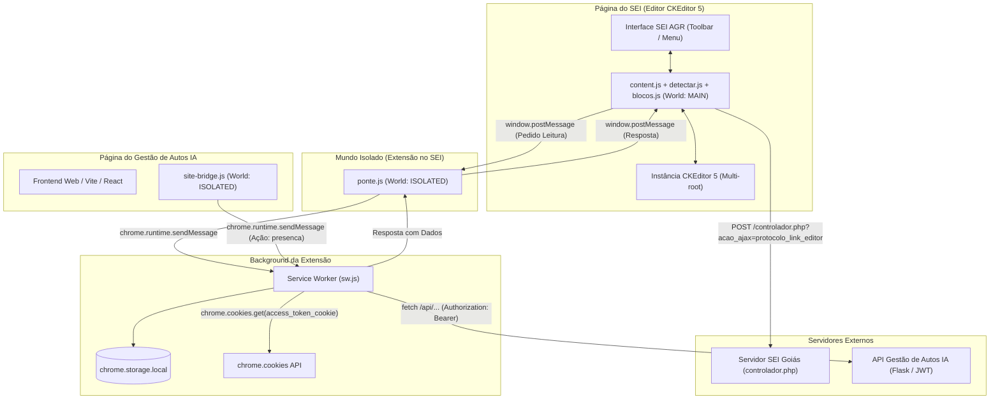
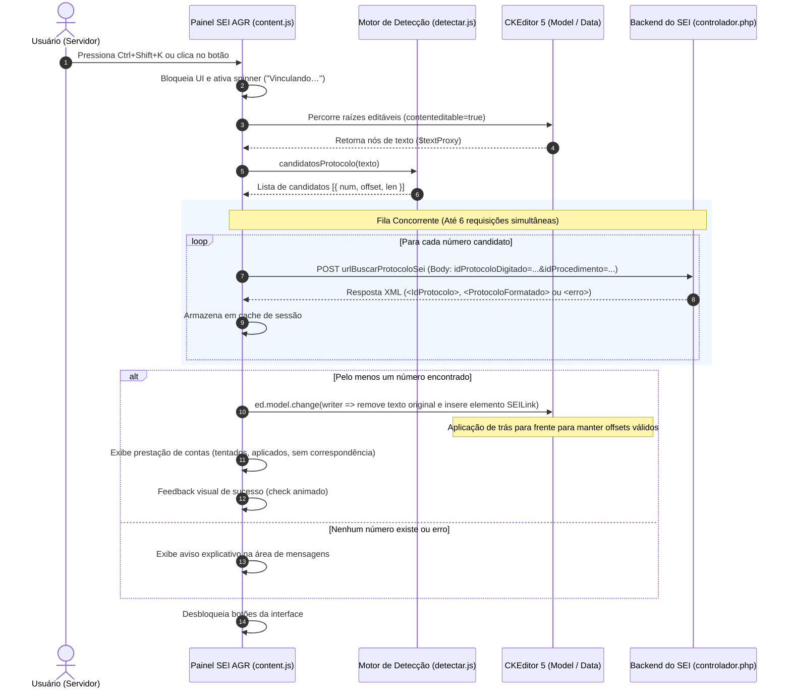
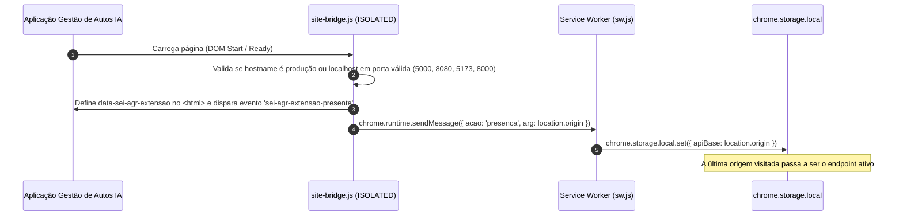
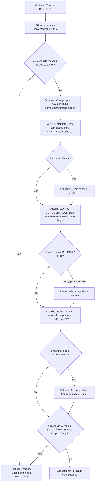
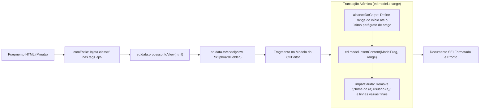

# Arquitetura e Fluxo de Operação — Extensão SEI AGR

Este documento descreve detalhadamente o funcionamento interno, fluxos de dados, arquitetura de segurança, heurísticas de mapeamento e integrações da extensão **SEI AGR (Link automático e Importação de Minutas)**. 

O objetivo deste documento é fornecer **total transparência técnica** sobre como a extensão interage com o **Sistema Eletrônico de Informações (SEI 5.x)** e com o sistema **Gestão de Autos IA**, assegurando aos auditores, desenvolvedores e usuários a conformidade com as melhores práticas de privacidade, isolamento de dados e integridade de documentos públicos.

---

## 1. Visão Geral e Princípios de Segurança

A extensão opera no navegador do usuário sob o modelo **Manifest V3 (MV3)** do Google Chrome / Chromium. Ela executa duas funções principais no editor de documentos do SEI:
1. **Linkar Protocolos em Lote (`Ctrl+Shift+K`)**: Detecta números de processos e documentos citados no texto e consulta o endpoint oficial do SEI para convertê-los em links internos (`SEILink`), sem adulterar textos não reconhecidos.
2. **Importar Resolução do Gestão de Autos IA**: Consulta a minuta gerada pelo sistema de IA e distribui seu conteúdo com precisão milimétrica entre os blocos estruturais do modelo do SEI (**Ementa**, **Considerandos/Corpo** e **Artigos**), respeitando a formatação oficial.

```
                  ┌─────────────────────────────────────────────────────────┐
                  │                 EXTENSÃO SEI AGR (MV3)                  │
                  └─────────────────────────────────────────────────────────┘
                                       │
            ┌──────────────────────────┴──────────────────────────┐
            ▼                                                     ▼
┌───────────────────────┐                             ┌───────────────────────┐
│   LINKAGEM EM LOTE    │                             │ IMPORTAÇÃO DE MINUTAS │
│   (Ctrl+Shift+K)      │                             │ (Gestão de Autos IA)  │
└───────────────────────┘                             └───────────────────────┘
            │                                                     │
            ▼                                                     ▼
┌───────────────────────┐                             ┌───────────────────────┐
│ • Regex determinístico│                             │ • Busca de processos  │
│ • Roots editáveis     │                             │ • Cookie JWT isolado  │
│ • 6 workers paralelos │                             │ • Heurística de roots │
│ • Endpoint nativo SEI │                             │ • Upcast do CKEditor  │
│ • Undo em 1 passo     │                             │ • Preserva assinatura │
└───────────────────────┘                             └───────────────────────┘
```

### Princípios Fundamentais de Transparência
* **Nenhuma Senha é Coletada ou Armazenada**: A extensão não possui telas de login nem armazena credenciais. A autenticação com o Gestão de Autos IA é herdada da sessão ativa do usuário no navegador via cookies seguros (`access_token_cookie`).
* **Isolamento Estrito de Tokens**: O token JWT obtido nunca é injetado no DOM ou no contexto da página do SEI (`MAIN world`). Ele reside exclusivamente na memória do Service Worker.
* **Sem Chamadas Ocultas ou Telemetria**: Apenas dois destinos de rede são acessados: o próprio servidor do SEI do Estado de Goiás (`*.go.gov.br`) e a API do Gestão de Autos IA (`gestao-autos.duckdns.org` ou instâncias locais autorizadas).
* **Idempotência e Não-Destrutividade**: Qualquer alteração efetuada no editor do SEI é registrada em uma única transação atômica (`model.change`), permitindo que a operação completa seja desfeita com um único `Ctrl+Z`.

---

## 2. Arquitetura de Componentes e Isolamento de Contextos (MV3)

A extensão é dividida em quatro camadas de execução para garantir o isolamento entre o contexto da página web e os privilégios da extensão:



### Componentes e Responsabilidades

| Arquivo | Contexto de Execução | Permissões / Acessos | Responsabilidade |
| :--- | :--- | :--- | :--- |
| **`detectar.js`** | `MAIN` (página SEI) | Sem privilégios `chrome.*` | Expressões regulares puras para identificação de números de processo/documento e processo de referência do rodapé. |
| **`blocos.js`** | `MAIN` (página SEI) | Sem privilégios `chrome.*` | Heurística pura de classificação de raízes (*roots*) do CKEditor 5, estilos de parágrafos, detecção de texto preexistente e remoção de cauda. |
| **`content.js`** | `MAIN` (página SEI) | Acesso total ao DOM e à instância do CKEditor | Montagem da UI na toolbar do SEI, orquestração da linkagem em lote, manipulação do modelo do CKEditor e interface de busca de minutas. |
| **`ponte.js`** | `ISOLATED` (página SEI) | `chrome.runtime.sendMessage` | Ponte de segurança via `window.postMessage` que encaminha pedidos do `MAIN` para o Service Worker sem expor APIs de extensão para scripts de terceiros. |
| **`site-bridge.js`** | `ISOLATED` (Gestão de Autos IA) | `chrome.runtime.sendMessage` | Identifica a presença da extensão para a aplicação web e notifica o Service Worker sobre qual URL/origem está ativa (produção vs localhost). |
| **`sw.js`** | `Service Worker` (Background) | `chrome.cookies`, `storage`, `host_permissions` | Gerencia chamadas HTTP autenticadas para a API do Gestão de Autos IA, extraindo o JWT dos cookies e anexando-o no cabeçalho `Authorization: Bearer`. |

---

## 3. Fluxo 1: Detecção e Linkagem de Protocolos SEI em Lote

Este fluxo é disparado pelo usuário pelo atalho **`Ctrl+Shift+K`** ou pelo botão **"Linkar protocolos"** no painel da extensão.



### Regras de Detecção (`detectar.js`)

A expressão regular utilizada é rigorosamente calibrada para capturar formatos oficiais de processo e documento, evitando falsos positivos:
$$\text{RE\_PROTOCOLO} = \verb|\b(\d{5}\.\d{6}\/\d{4}-\d{2}|\verb|\d{15,17}|\verb|\d{7,9})\b|$$

* **Documento SEI**: 7 a 9 dígitos numéricos contínuos (ex: `80773781`).
* **Processo SEI sem máscara**: 15 a 17 dígitos numéricos (ex: `202600005004296`).
* **Processo SEI com máscara**: `\d{5}\.\d{6}/\d{4}-\d{2}` (ex: `12345.678901/2026-99`).
* **Faixa Excluída (10 a 14 dígitos)**: Telefones fixos e celulares com DDD, CEPs combinados com dígitos adjacentes e inscrições estaduais não viram candidatos.
* **Formatos Imunes**: CNPJ, CPF, datas (`DD/MM/AAAA`) e valores monetários possuem grupos de no máximo 4 dígitos entre pontuações e são ignorados pelo delimitador de borda de palavra (`\b`).

### Detalhes Técnicos de Integração com o SEI
1. **Parâmetros no Corpo do POST**: A URL de busca do SEI (`ed.config.get('sei').urlBuscarProtocoloSei`) contém um hash de integridade (`infra_hash`). Enviar parâmetros na Query String corrompe esse hash, resultando em erro `Tamanho de hash inválido` e redirecionamento forçado para o login. Os parâmetros são transmitidos estritamente no corpo via `application/x-www-form-urlencoded`.
2. **Elemento de Modelo Nativo**: O SEI utiliza uma entidade rica do CKEditor chamada `SEILink`. A extensão instancia `writer.createElement('SEILink', { id, text })`, onde `id` é o `id_protocolo` interno devolvido pelo servidor (diferente do número digitado).
3. **Escrita Reversa**: As alterações de texto ocorrem do maior deslocamento (*offset*) para o menor dentro de cada nó pai, assegurando que as substituições não invalidem as coordenadas das substrings anteriores.

---

## 4. Fluxo 2: Reconhecimento de Origem e Presença (`site-bridge.js`)

Para suportar tanto o ambiente de produção em nuvem quanto ambientes de desenvolvimento local, a extensão detecta automaticamente onde o usuário está trabalhando.



* **Detecção Bidirecional**: O site pode enviar um evento `sei-agr-ping` ou mensagem `window.postMessage({ tipo: 'SEI_AGR_PING' })`, e a extensão responde com `sei-agr-pong`, permitindo que o frontend web exiba um selo *"Extensão Conectada"*.
* **Proteção de Portas**: Em `localhost` e `127.0.0.1`, a extensão só se ativa em portas dedicadas do ecossistema (`5000` Docker, `8080` Flask, `5173` Vite, `8000` API auxiliar), prevenindo interferência em outros servidores locais de desenvolvimento.

---

## 5. Fluxo 3: Importação de Resoluções do Gestão de Autos IA

Permite importar minutas estruturadas diretamente para o modelo de Resolução da Agência Goiana de Regulação (AGR).

```mermaid
sequenceDiagram
    autonumber
    actor Usuario as Usuário (Servidor)
    participant UI as Painel SEI AGR (content.js)
    participant Ponte as ponte.js (ISOLATED)
    participant SW as Service Worker (sw.js)
    participant Cookies as chrome.cookies
    participant GA as API Gestão de Autos IA
    participant CK as CKEditor 5 (Model)

    Usuario->>UI: Clica em "Importar Resolução"
    UI->>UI: Renderiza caixa de busca no painel
    UI->>Detect: processoDeReferencia(document.body.innerText)
    Detect-->>UI: Preenche campo de busca com número do processo da página

    UI->>Ponte: postMessage({ acao: 'recentes' })
    Ponte->>SW: runtime.sendMessage({ acao: 'recentes' })
    SW->>Cookies: get(access_token_cookie)
    Cookies-->>SW: Retorna JWT
    SW->>GA: GET /api/history?limit=8 (Header: Authorization: Bearer JWT)
    GA-->>SW: Retorna lista de processos recentes
    SW-->>Ponte: Retorna JSON
    Ponte-->>UI: postMessage({ payload })
    UI->>UI: Renderiza lista de itens selecionáveis

    Usuario->>UI: Seleciona um processo ou digita e aperta Enter
    UI->>UI: Valida estrutura do documento SEI (mapearBlocos)
    
    opt Se houver texto do usuário nos blocos
        UI->>Usuario: window.confirm("Substituir texto existente?")
        Usuario-->>UI: Confirma
    end

    UI->>Ponte: postMessage({ acao: 'resolucao', arg: numProcesso })
    Ponte->>SW: runtime.sendMessage({ acao: 'resolucao' })
    SW->>GA: GET /api/processo/<num>/resolucao
    GA-->>SW: Retorna { ementa, considerandos, artigos } em HTML
    SW-->>Ponte-->>UI: Retorna fragmentos HTML

    UI->>CK: Converte HTML em ModelFragment ($clipboardHolder)
    UI->>CK: ed.model.change(writer => insertContent nos 3 blocos + limparCauda)
    UI->>UI: Exibe resumo de sucesso ("3 de 3 blocos preenchidos")
```

---

## 6. Heurística de Mapeamento de Raízes Multi-Root (`blocos.js`)

O editor do SEI 5 trabalha com múltiplos elementos-raiz (*multi-root CKEditor*), onde cada parágrafo ou seção do formulário possui um identificador interno (`txaEditor_<id>`) gerado dinamicamente pelo banco de dados do SEI.

Para identificar onde deve entrar a **Ementa**, onde entram os **Considerandos** e onde entram os **Artigos**, a extensão utiliza uma cascata de decisão:



### Detalhes Estruturais das Raízes da AGR

| Ordem Visual | Bloco / Função | Identificador Principal | Estilo Padrão do Parágrafo | Comportamento na Importação |
| :---: | :--- | :--- | :--- | :--- |
| **0** | **Título da Resolução** | 1º editável visual | `Texto_Centralizado_Maiusculas` | **Intacto** (não é alterado) |
| **1** | **Ementa** | Estilo `Texto_Ementa` | `Texto_Ementa` | **Substituído** pelo HTML da Ementa |
| **2** | **Considerandos / Corpo** | Anterior à Seção Principal | `Texto_Justificado_Recuo_Primeira_Linha` | **Substituído** pelos Considerandos |
| **3** | **Artigos (Seção Principal)** | Classe `infra-editor__secao-principal` | `Texto_Justificado_Recuo_Primeira_Linha_Esp_Simples` | **Substituído** até o último artigo |
| **Cauda** | **Assinatura e Fecho** | Final do bloco de artigos | `Texto_Centralizado` | **Marcador removido / Nomes reais preservados** |

---

## 7. Pipeline de Colagem e Preservação Estilística

A inserção manual de texto formatado no CKEditor costuma enfrentar dois problemas críticos: quebra de herança de estilos CSS e desincronização de seleção em editores *multi-root*. A extensão contorna esses obstáculos com as seguintes técnicas:



### Limpeza Cirúrgica de Cauda (`limparCauda`)
No modelo padrão do SEI, os últimos parágrafos da seção principal contêm um marcador textual de assinatura: `[Nome do (a) usuário (a)]`.
1. **Identificação por Regex Restritivo**:
   $$\text{RE\_ASSINATURA\_MODELO} = \verb|/^\[[^\]]*nome[^\]]*usu[áa]rio[^\]]*\]$/i|$$
   * Se o usuário já tiver digitado um nome real (ex: `JOÃO DA SILVA`), o regex **não** casa, garantindo que reimportações não apaguem nomes verdadeiros.
2. **Remoção de Espaçadores Vazios (`vaziosDoFim`)**:
   Remove parágrafos vazios ao final do bloco (incluindo espaços de largura zero `U+200B` e `&nbsp;`), preservando sempre pelo menos um parágrafo estrutural para não corromper o modelo interno da engine.

---

## 8. Matriz de Segurança, Privacidade e Tratamento de Erros

A tabela abaixo resume as salvaguardas implementadas contra riscos comuns em extensões de navegador:

| Vetor de Risco | Risco Potencial | Mitigação Implementada na Extensão SEI AGR |
| :--- | :--- | :--- |
| **Injeção de Código (XSS)** | Injeção de scripts maliciosos através de nomes de processos ou metadados de PDF. | Toda renderização de dados no painel é feita via `document.createTextNode` e propriedades `.textContent`. Uso de `innerHTML` é estritamente proibido para dados dinâmicos. |
| **Vazamento de Credenciais** | Exposição do token de autenticação para a página do SEI ou scripts de terceiros. | O `MAIN world` se comunica com o `ISOLATED world` exclusivamente por mensagens com IDs estritos. O token JWT permanece retido no Service Worker. |
| **CORS / Requisições Indevidas** | Bloqueio de chamadas cross-origin ou emissão de requisições arbitrárias. | O Service Worker realiza as chamadas sob `host_permissions` específicas, garantindo que o content script não precise contornar CORS na página do SEI. |
| **Corrupção de Documento** | Colagem de texto no bloco errado ou falha parcial na rede. | Todas as conversões de fragmento são validadas **antes** de abrir a transação do modelo. A escrita nos 3 blocos ocorre dentro de um único `ed.model.change`. |
| **Conflito de CSS no Editor** | Estilos da extensão desconfigurarem a interface do SEI ou serem sobrescritos pelo reset do CKEditor. | Todos os seletores CSS utilizam a âncora de ID `#seiAgrMenu` (especificidade mínima `(1,0,0)`), superando o reset global `.ck-reset_all` sem poluir o escopo global. |

---

## 9. Suíte de Testes e Diagnóstico

A integridade do código é mantida através de uma suíte de testes em Node.js sem dependências pesadas, permitindo validação rápida em qualquer ambiente:

* **`test-deteccao.js`**: Valida a extração de números de processo e documento contra cenários reais, rodapés de referência e casos contendo ruídos (CPFs, CNPJs, datas e telefones).
* **`test-blocos.js`**: Simula árvores completas do CKEditor 5 nos formatos de modelo **Novo (AGR)** e **Antigo (Treinamento)**, assegurando que as heurísticas de ordenação e detecção de placeholders funcionem sem falhas.
* **`test-contraste.js`**: Avalia matematicamente todas as 19 combinações de cores da interface contra os critérios **WCAG 2.1 AA** (relação de contraste mínima de 4.5:1 para texto normal e 3.0:1 para componentes de UI).
* **`test-visual.js`**: Extrai o CSS real embutido em `content.js` e renderiza um mock visual isolado (`test-visual.html` e `test-visual.png`).
* **`diagnostico-resolucao.js`**: Script utilitário para execução no console do navegador (F12) caso o SEI passe por atualizações de versão, permitindo inspecionar a estrutura real de raízes ativas.

---

> **Desenvolvido para a Agência Goiana de Regulação, Controle e Fiscalização de Serviços Públicos (AGR)**  
> *Transparência, eficiência e segurança na gestão de processos públicos.*

